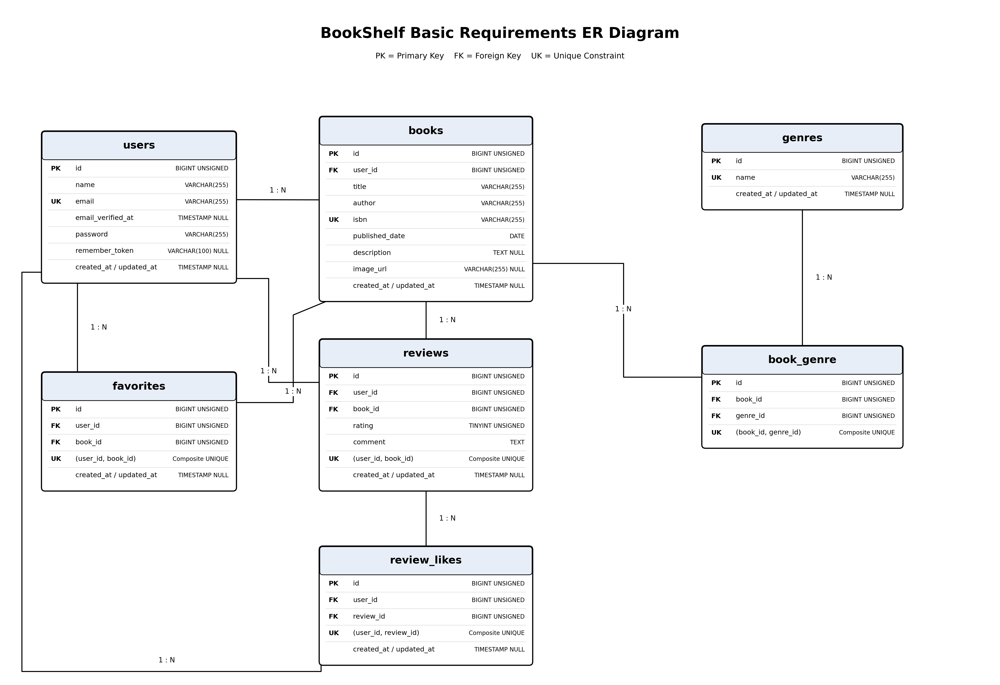

# COACHTECH BookShelfアプリ

書籍の登録・検索・レビュー投稿ができる書籍レビューアプリです。
ユーザー同士で書籍の評価や感想を共有でき、読書計画や読書レポートを通じて読書活動を管理できます。

## 作成者

石川浩子

## 使用技術

- PHP 8.5.12
- Laravel 12.73.0
- MySQL 8.4
- Docker / Laravel Sail
- Laravel Fortify
- Laravel Sanctum
- JavaScript
- Alpine.js
- Vite
- Tailwind CSS

## ER図

## URL

http://localhost

## 環境構築

### 1. リポジトリのクローン

git clone https://github.com/hiroko-kiriten/bookshelf-app.git

### 2. ディレクトリ移動

cd bookshelf-app

### 3. 環境設定ファイルの作成

cp .env.example .env

### 4. Composer依存関係のインストール

docker run --rm \
    -v "$(pwd):/app" \
    -w /app \
    --entrypoint /usr/bin/composer \
    sail-8.5/app install

### 5. Dockerコンテナの起動

./vendor/bin/sail up -d

### 6. アプリケーションキーの生成

./vendor/bin/sail artisan key:generate

### 7. データベースのマイグレーション・シーディング

./vendor/bin/sail artisan migrate --seed

### 8. JavaScript依存関係のインストール

./vendor/bin/sail npm ci

### 9. フロントエンドのビルド

./vendor/bin/sail npm run build

### 10. アプリケーションへのアクセス

http://localhost

## 実装機能

### ユーザー認証

- ユーザー登録
- ログイン・ログアウト
- パスワードリセット
- パスワード変更
- 二段階認証

### 書籍管理

- 書籍一覧表示
- 書籍登録・編集・削除
- 書籍詳細表示
- キーワード検索
- ジャンルによる絞り込み
- ソート
- ページネーション
- ISBNによる書籍情報検索

### ジャンル管理

- ジャンル登録・編集・削除

### レビュー機能

- レビュー投稿・編集・削除
- レビューへのいいね

### お気に入り機能

- 書籍のお気に入り登録・解除

### ランキング機能

- 書籍ランキング表示

### 読書計画機能

- 読書計画の登録・編集・削除
- 読書計画のステータス管理
- 読了予定日の管理

### 通知機能

- 読了予定日に関する通知
- 読書計画の期限管理
- 通知の既読管理

### マイ読書レポート

- レビュー件数
- 平均評価
- 評価分布
- 読了冊数
- ジャンル別評価傾向
- 高評価書籍

## API

### 公開API

| HTTPメソッド | URI | 機能 |
|---|---|---|
| GET | /api/v1/books | 書籍一覧取得 |
| GET | /api/v1/books/{book} | 書籍詳細取得 |
| GET | /api/v1/books/{book}/reviews | 書籍レビュー取得 |

### 認証が必要なAPI

| HTTPメソッド | URI | 機能 |
|---|---|---|
| POST | /api/v1/books | 書籍登録 |
| PUT | /api/v1/books/{book} | 書籍更新 |
| DELETE | /api/v1/books/{book} | 書籍削除 |
| DELETE | /api/v1/token | 認証トークン削除 |

API認証にはLaravel Sanctumを使用しています。

## テスト

テスト実行コマンド

./vendor/bin/sail artisan test
