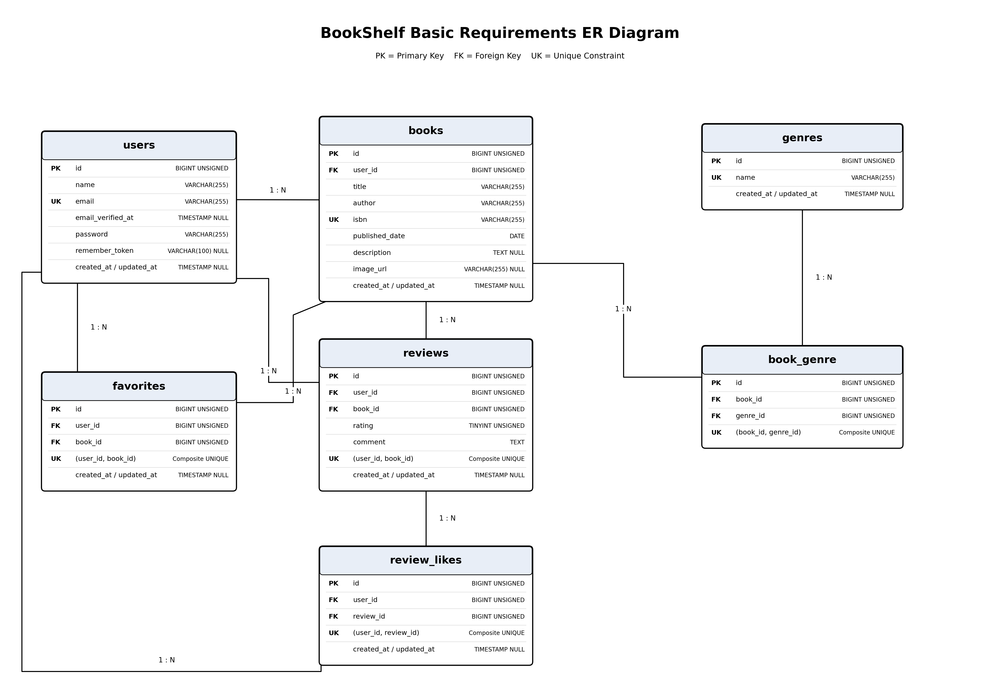

# COACHTECH BookShelfアプリ

書籍の登録・検索・レビュー投稿ができる書籍レビューアプリです。
ユーザー同士で書籍の評価や感想を共有できます。

## 作成者

石川浩子

## 使用技術

- PHP 8.5.12
- Laravel 10.50.3
- MySQL 8.4.9
- Laravel Fortify
- Laravel Sanctum
- JavaScript
- Alpine.js 3.17.5
- Vite 5
- Docker / Laravel Sail
- Node.js 24.22.1
- npm 12.2.1

## ER図



## 開発環境URL

- アプリケーション：http://localhost

## 動作環境

- Docker
- Docker Compose
- PHP 8.5
- MySQL 8.4

## 環境構築手順

1. リポジトリをクローンする

   ```bash
   git clone https://github.com/hiroko-kiriten/bookshelf-app.git
   cd bookshelf-app
   ```

2. 環境設定ファイルを作成する

   ```bash
   cp .env.example .env
   ```

3. Composerの依存パッケージをインストールする

   ```bash
   docker run --rm -u "$(id -u):$(id -g)" -v "$(pwd):/var/www/html" -w /var/www/html laravelsail/php84-composer:latest composer install
   ```

4. Sailを起動する

   ```bash
   ./vendor/bin/sail up -d
   ```

5. アプリケーションキーを生成する

   ```bash
   ./vendor/bin/sail artisan key:generate
   ```

6. マイグレーションと初期データの登録を行う

   ```bash
   ./vendor/bin/sail artisan migrate --seed
   ```

7. フロントエンドの依存パッケージをインストールし、ビルドする

   ```bash
   ./vendor/bin/sail npm ci
   ./vendor/bin/sail npm run build
   ```

8. ブラウザからアクセスする

   http://localhost

## テスト実行

```bash
./vendor/bin/sail artisan test
```

## 機能一覧

- ユーザー登録・ログイン・ログアウト
- パスワード再設定・変更
- 書籍一覧・詳細表示
- 書籍登録・編集・削除
- ジャンル一覧・登録・編集・削除
- レビュー投稿・編集・削除
- レビューへのいいね
- お気に入り登録・解除・一覧表示
- 評価ランキング表示

※書籍・レビューの編集および削除は登録者本人のみ可能です。
※書籍一覧・詳細およびランキングは未ログインでも閲覧できます。

## APIエンドポイント一覧

書籍情報およびレビュー情報を取得するための公開APIです。

| HTTPメソッド | URI | 概要 |
|---|---|---|
| GET | /api/v1/books | 書籍一覧取得 |
| GET | /api/v1/books/{book} | 書籍詳細取得 |
| GET | /api/v1/books/{book}/reviews | 指定書籍のレビュー一覧取得 |
